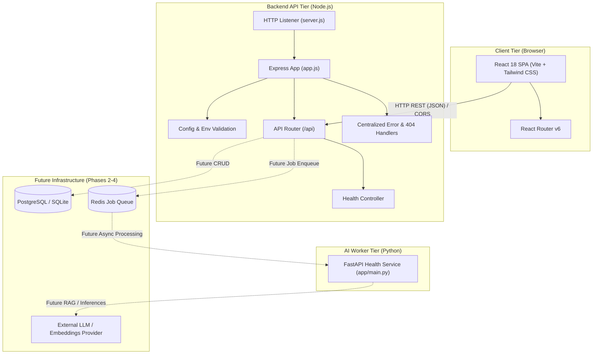

# ResolveOps System Architecture

This document provides a concise architectural overview of ResolveOps, designed for maintainability, interview clarity, and progressive feature expansion.

---

## 1. System Overview & Philosophy

ResolveOps is an incident management and support platform built for small software engineering teams. It bridges customer support workflows with technical incident operations.

### Design Principles

- **Separation of Concerns:** Business logic, HTTP routing, environment configuration, and UI presentation are strictly separated.
- **Progressive Delivery:** The foundation is established first (HTTP contracts, layouts, routing, health probes) before introducing stateful persistence, queueing, or LLM integrations.
- **Clarity over Cleverness:** Built using standard, idiomatic patterns (Express controllers/services, React functional components with custom hooks) that are straightforward to explain and debug.

---

## 2. High-Level Architecture Diagram

---

## 3. Component Details

### A. Frontend (`/frontend`)
- **Vite + React:** Modern, fast build tool and React 18 single-page application.
- **Tailwind CSS:** Utility-first CSS configured with custom neutral palette for a restrained, professional B2B SaaS appearance.
- **Layout Architecture:**
  - `AppLayout`: Persistent sidebar and top navbar wrapping an `<Outlet />` for page routing.
  - Responsive behavior: Mobile drawer toggle and adaptive tables for small viewports.
- **Pages & Routes:**
  - `/` (Dashboard): Metrics summary cards, recent tickets demo table, recent activity feed.
  - `/tickets` (Inbox): Client-side search and status/priority filters over demo tickets.
  - `/tickets/:ticketId` (Detail): Dynamic route displaying ticket context and placeholder for conversational thread and AI response generation.
  - `/knowledge` (Knowledge Base): Search and document hierarchy placeholder for future RAG index.
  - `/settings` (Settings): Configuration placeholder for team, webhooks, and AI models.

### B. Backend (`/backend`)
- **Express.js (ES Modules):** Clean REST API server.
- **Separation of Startup and Configuration:**
  - `src/app.js`: Configures middleware (CORS, JSON parsing), routes, 404 handler, and centralized error handler without listening on a port. This makes automated testing seamless.
  - `src/server.js`: Validates configuration, binds to the HTTP port, and attaches process termination hooks (`SIGTERM`, `SIGINT`) for graceful shutdown.
- **Routing & Controllers:**
  - `routes/health.routes.js` maps `GET /api/health` to `controllers/health.controller.js`.
  - Business logic is delegated to `services/health.service.js`.
- **Error Handling:**
  - `middleware/notFoundHandler.js`: Standardized JSON response for unmapped endpoints.
  - `middleware/errorHandler.js`: Intercepts thrown exceptions, logs them to server console, and returns consistent JSON errors without leaking stack traces in production.
- **Persistence and authorization:** PostgreSQL stores users, organizations, memberships, tickets, comments, and ticket activity. Firebase Admin verifies the bearer token first; ticket services then resolve the Firebase UID to a database user and enforce organization membership and role permissions before every query or mutation.

### C. AI Worker (`/ai-worker`)
- **FastAPI (Python):** Lightweight, asynchronous service.
- **Phase 1 Role:** Runs a `/health` endpoint to establish the service contract and local environment.
- **Future Role:** Consumes asynchronous queue tasks (ticket categorization, sentiment analysis, document embedding generation, and drafting responses).

---

## 4. Environment and Secrets Strategy

- Secrets and variable configurations are kept out of version control via `.gitignore`.
- Explicit `.env.example` templates document every expected key.
- Safe fallbacks exist for local development (e.g., default `PORT=5000`, `CORS_ORIGIN=http://localhost:5173`).

---

## 5. Roadmap

| Phase | Milestone | Scope |
|---|---|---|
| **Phase 1 (Current)** | Foundation & Scaffolding | Layout, navigation, Express server, health probes, AI worker placeholder, docs. |
| **Phase 2** | Persistence & Tickets | Database integration, ticket schema, CRUD REST endpoints, real ticket creation. |
| **Phase 3** | AI & Knowledge Base | Vector embeddings, knowledge document store, background worker queue (Redis). |
| **Phase 4** | Auth & Multi-Tenancy | JWT authentication, role-based access control, incident resolution workflows. |
